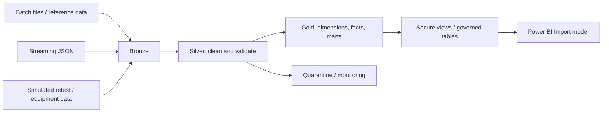
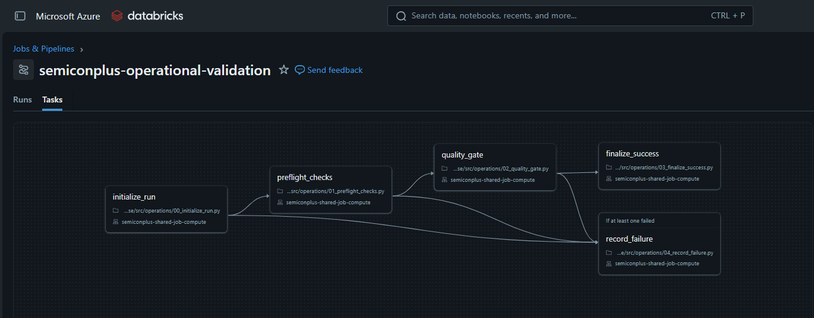
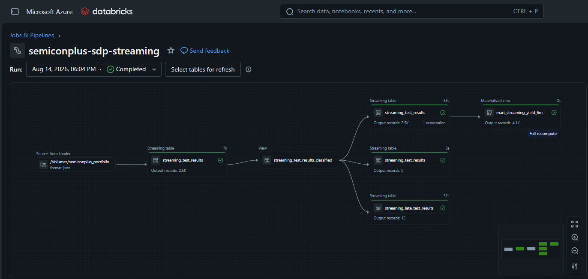
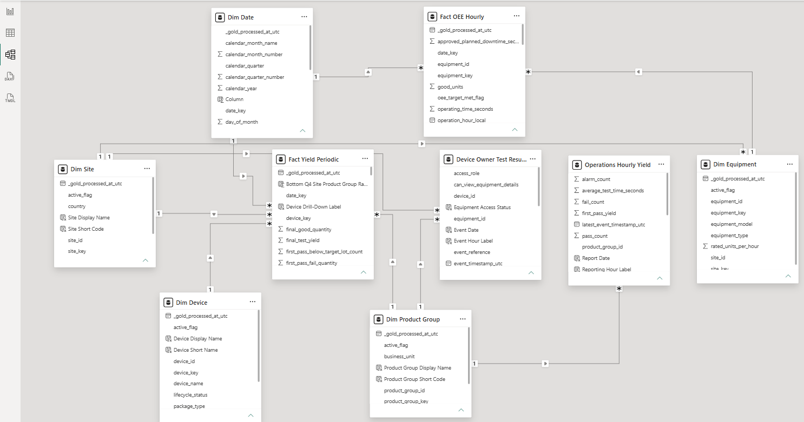
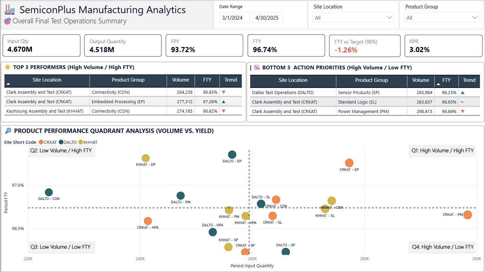
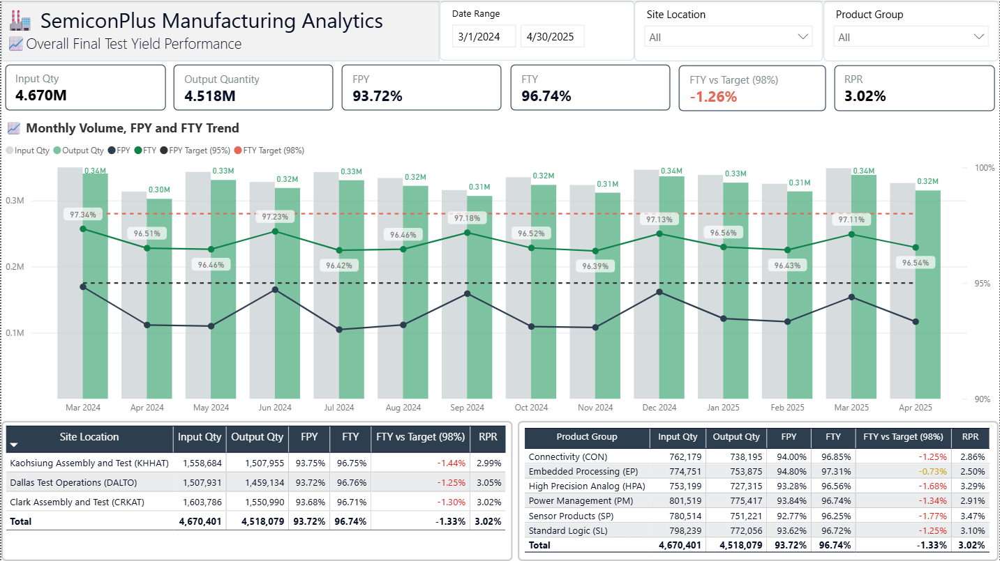
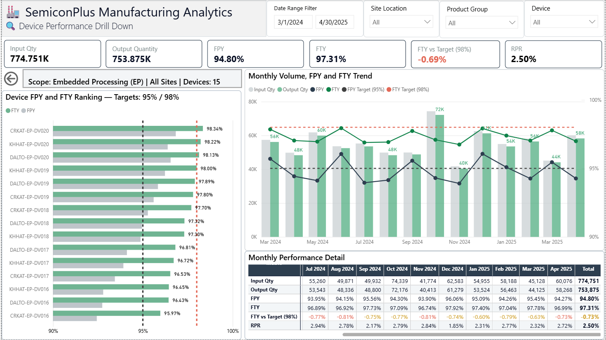
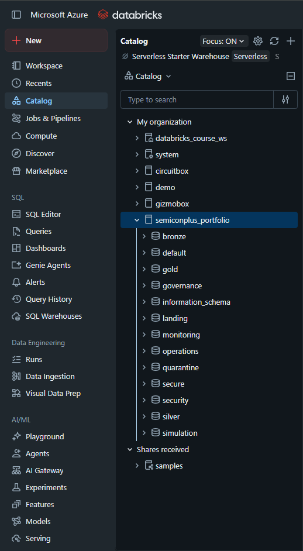
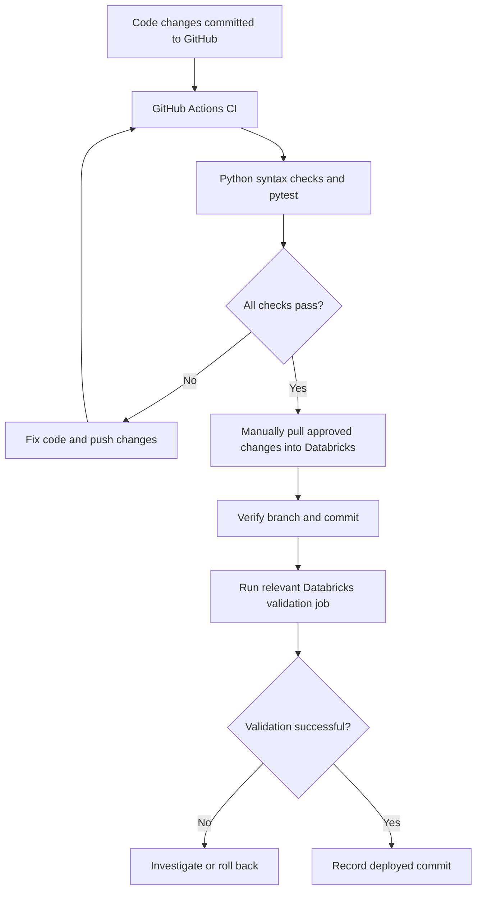

# 📊 SemiconPlus — Semiconductor Manufacturing Lakehouse

End-to-end manufacturing data engineering portfolio built with **Azure Databricks, PySpark, Spark SQL, Delta Lake, Unity Catalog, and Power BI**. Demonstrates batch and streaming ingestion, dimensional modeling, data quality, and governed analytics.

> **Public portfolio:** All manufacturing datasets used in this project are fully synthetic. No real production, customer, or proprietary manufacturing data is included.

## 🔎 Problem and Engineering Value

Semiconductor analytics combines production lots, unit tests, equipment events, and reference data from different sources. Inconsistent identifiers, test flows, and KPI definitions complicate reliable reporting.

SemiconPlus organizes these datasets into a **Bronze → Silver → Gold lakehouse**, providing reusable manufacturing facts, dimensions, secure serving views, and a three-page Power BI report. This is a portfolio demonstration; quantified production savings are **not** claimed.

## ⚙️ Processing Workflow

1. **Ingest:** Load batch manufacturing/reference files and demonstration streaming JSON events into Bronze Delta tables.
2. **Standardize:** Validate and clean records in Silver, including dedicated handling for late-arriving streaming results.
3. **Model:** Build Gold dimensions, SCD Type 2 device history, yield/retest/equipment facts, and analytical marts.
4. **Validate:** Record data-quality results, ingestion audits, and rejected records in monitoring/quarantine datasets.
5. **Serve:** Expose governed views and Gold tables to a Power BI Import semantic model.
6. **Operate:** Use Databricks pipelines/workflows and operational validation; separately refresh Power BI Import data when required.



### Databricks Batch Workflow



## ▶️ How to Run / Reproduce

**Requirements:** An Azure Databricks workspace with Unity Catalog access, permission to create the required catalog/schema objects and volumes, and access to the project notebooks, jobs, and pipeline definitions. **Power BI Desktop** is optional for viewing or updating the report. Cloud compute and storage may incur charges.

This is a **cloud lakehouse project**, not a standalone Python script. The execution order below describes the architecture; exact notebook paths, job names, permissions, and deployment commands must be confirmed against the published repository before this becomes a one-command reproducible setup.

1. **Prepare the workspace.** Import or clone the repository into Databricks. Configure a development environment and verify permissions for the `semiconplus_portfolio` catalog, schemas, and Unity Catalog landing volumes. Do not commit workspace tokens, credentials, or sensitive configuration.
2. **Stage synthetic inputs.** Upload the synthetic batch manufacturing and reference datasets to their expected landing volume paths. Stage synthetic retest/equipment inputs separately. For the streaming demonstration, use the configured synthetic JSON input volume.
3. **Run batch ingestion and transformations.** Execute the repository's configured notebooks/jobs in dependency order: reference and source ingestion → Bronze → Silver → Gold dimensions → Gold facts/marts → secure views. Confirm notebook/job paths from the repository rather than assuming filenames.
4. **Run the streaming demonstration.** Start the configured Databricks streaming pipeline and provide sample JSON events. Verify Bronze/Silver streaming tables, late-data handling, and `gold.mart_streaming_yield_5m`. Stop compute after validation to control costs.
5. **Validate outputs.** Review `monitoring.data_quality_results`, `monitoring.ingestion_audit`, relevant `quarantine` tables, and operational workflow logs. Check that Gold and secure-view results are populated and KPI denominators are valid.
6. **Open the Power BI report.** In Power BI Desktop, configure the Databricks connection and credentials for your own workspace, refresh the Import model, and inspect the three report pages. A Databricks pipeline run alone does **not** refresh an imported Power BI semantic model.

**Reproducibility note:** This README does not claim that the public repository already includes every sample input, deployment configuration, or executable job dependency. Add exact commands and verified paths after the repository and workflow definitions are checked. Never publish production data or credentials.

---

## 🧩 Data Modeling and Warehousing

SemiconPlus uses an **OLAP-oriented dimensional model** for analytical queries, rather than acting as an OLTP transaction system.

| Concept | SemiconPlus example | Purpose |
| --- | --- | --- |
| **Star schema** | Yield facts linked to conformed date, device, site, product-group, and lot dimensions | Simple, reusable BI filtering and aggregation |
| **Fact tables** | `gold.fact_lot_performance`, `gold.fact_yield_periodic`, `gold.fact_oee_hourly` | Measurements at defined reporting grains |
| **Dimension tables** | `gold.dim_date`, `gold.dim_device`, `gold.dim_site`, `gold.dim_equipment` | Descriptive context for facts |
| **SCD Type 2** | `gold.dim_device_scd2` | Preserve historical versions of device attributes |
| **Analytical marts** | `gold.mart_daily_yield`, `gold.mart_device_yield`, `gold.mart_equipment_oee_daily` | Curated summaries for recurring analysis |

**Modeling decision:** Star-schema-oriented serving simplifies Power BI consumption through reusable facts and dimensions. The current `dim_device` and historical `dim_device_scd2` serve distinct analytical needs.

### Databricks Data Lineage

The following diagram illustrates the main production-lot processing path from Bronze ingestion through Silver standardization and Gold analytical modeling.


The complete upstream and downstream dependencies can be inspected using Unity Catalog's Lineage tab in Azure Databricks.

## ⚡ PySpark and Streaming

- **DataFrames / Spark SQL:** Joins, standardization, aggregation, dimensional transformations, and Delta writes.
- **Structured Streaming / Auto Loader:** JSON ingestion into Bronze and Silver streaming tables.
- **Late-data handling:** Separate `silver.streaming_late_test_results` dataset.
- **Materialized aggregation:** `gold.mart_streaming_yield_5m`.
- **Optimization considerations:** Filter/project early, avoid unnecessary shuffles, inspect join strategies, and measure performance before claiming gains.

**RDDs** and typed **Datasets** are relevant Spark concepts but are **not claimed as separate implemented APIs** in this PySpark portfolio.

### Databricks Streaming Pipeline

The streaming demonstration uses Auto Loader, Bronze and Silver streaming tables, late-arriving test-result handling, and a Gold materialized view for five-minute yield aggregation.



## 📐 Manufacturing KPI Definitions

| KPI | Project definition |
| --- | --- |
| **FPY** | First-pass passing units ÷ first-pass tested units |
| **FTY** | Final yield after applicable retest flows |
| **RPR** | FTY − FPY (percentage-point recovery) |
| **LRR** | Lots below the FTY target ÷ total eligible lots in the reporting period |
| **OEE** | Availability × Utilization × FTY (project-specific definition) |

Project targets include **FPY ≥ 95%**, **FTY ≥ 98%**, and **OEE ≥ 80%**. These are project rules, not universal semiconductor standards. Final-test metrics depend on successful retest enrichment and should not be inferred from first-pass-only records.

## 📊 Power BI Reporting

The project includes a three-page Power BI report backed by an Import semantic model, integrating governed Databricks views and Gold analytical tables.

### Power BI Semantic Model

The semantic model uses fact and dimension relationships to support manufacturing yield, retest, and equipment performance analysis.



### Manufacturing Analytics Dashboards

**Dashboard Page 1**



**Dashboard Page 2**



**Dashboard Page 3**



**Refresh limitation:** The Import semantic model requires a separate refresh after Databricks processing. Automated Power BI Service refresh is a potential future enhancement.

## 🏗️ System Design and Engineering Decisions

| Decision | Rationale / trade-off |
| --- | --- |
| **Azure Databricks + Spark** | Common environment for distributed transformations, pipelines, and analytical tables; requires cloud cost management |
| **Delta Lake + medallion layers** | Separates raw ingestion, quality-controlled records, and analytics-ready outputs; introduces additional storage/processing stages |
| **Batch + streaming** | Supports recurring source files and event-driven demonstrations; streaming adds checkpoint, lateness, and recovery considerations |
| **Star-schema-oriented Gold model** | Reusable BI facts and dimensions; requires clear grain and relationship management |
| **SCD Type 2** | Supports historical device analysis; adds versioning and effective-date complexity |
| **Unity Catalog + secure views** | Separates governed analytical access from underlying datasets; permissions require environment-specific verification |
| **Power BI Import** | Responsive dashboard interactions; requires explicit data refresh |
| **Quality, quarantine, and audit tables** | Improves traceability of invalid inputs and pipeline outcomes; operational checks must be maintained |

**System design discussion:** The primary design challenge is keeping batch and streaming sources reliable while maintaining consistent manufacturing keys, correct KPI grains, and governed reporting. A production-scale deployment would additionally require measured throughput/cost targets, recovery testing, permissions verification, and service-level objectives.

### Unity Catalog Organization



## CI/CD & Automated Testing

SemiconPlus uses **GitHub Actions for Continuous Integration (CI)** and **manual Git-based deployment to Azure Databricks**. This approach provides automated code validation while keeping cloud execution and deployment under manual control.

### CI/CD Workflow



### Automated CI Checks

The CI workflow is defined in `.github/workflows/ci.yml` and runs on pushes and pull requests targeting `main`. It can also be triggered manually using GitHub Actions.

The workflow:

1. Checks out the repository.
2. Configures Python 3.11 and Java 17.
3. Installs project dependencies from `requirements.txt`.
4. Checks Python syntax using `compileall`.
5. Executes automated unit tests using `pytest`.

**Latest verified result: 9 passed, 0 failed.**

### Unit Test Coverage

The nine custom unit tests are defined in `tests/unit/test_data_generator.py`. These tests are written as part of the SemiconPlus project, rather than generated automatically by GitHub.

| Test | Purpose |
|---|---|
| `test_reference_entity_counts` | Verifies expected reference-data record counts. |
| `test_reference_foreign_keys` | Checks relationships between generated reference entities. |
| `test_generator_creates_required_directories` | Verifies creation of required output directories. |
| `test_generated_date_coverage` | Checks the expected date coverage of generated data. |
| `test_expected_quality_failures_are_generated` | Verifies that intentional data-quality failure scenarios are generated. |
| `test_manifest_counts_match_generated_files` | Checks consistency between generated files and manifest counts. |
| `test_generated_json_is_readable` | Verifies that generated JSON files can be parsed. |
| `test_validator_passes_generated_dataset` | Checks that the generated dataset passes the project validator. |
| `test_fixed_seed_produces_same_business_data` | Verifies deterministic generation using a fixed random seed. |

The tests are executed with:

```bash
python -m pytest tests/unit -v
```

**How the testing components work together:**

- **Custom Python unit tests** define the expected behavior.
- **pytest** discovers, executes, and evaluates those tests.
- **GitHub Actions** automatically runs pytest according to the CI workflow configuration.

GitHub Actions automates test execution; it does not automatically create the unit tests.

### Manual Deployment to Databricks

After a successful CI run, approved changes are manually synchronized to the Databricks Git folder.

The deployment procedure is:

1. Confirm that GitHub Actions CI has passed for the intended commit.
2. Open the SemiconPlus Git folder in Azure Databricks.
3. Pull the approved changes from GitHub.
4. Verify the active branch and synchronized commit.
5. Review the affected Databricks Job or streaming pipeline.
6. Execute relevant validation when appropriate.
7. Inspect job results and record the deployed commit.

SemiconPlus uses Databricks Jobs for batch processing and operational validation, and a triggered streaming pipeline for streaming workloads.

### Scope and Limitations

The current CI workflow validates Python syntax and runs nine unit tests focused on synthetic data generation. It does not automatically execute Databricks batch jobs, streaming pipelines, or the project's integration and data-quality test suites.

Deployment is manual, not an automated production release. Live pipeline validation is performed separately in Databricks.

This design keeps the portfolio environment lightweight and limits unnecessary cloud compute usage.

For detailed operational procedures, validation steps, and rollback guidance, see [`docs/PIPELINE_OPERATIONS.md`](docs/PIPELINE_OPERATIONS.md).

## 🧪 Engineering Scope and Limitations

The portfolio demonstrates **ingestion, transformations, data-quality/error handling, dimensional modeling, orchestration, and reporting** using fully synthetic manufacturing data. Databricks monitoring, workflow, and quarantine tables exist in the project. Specific performance improvements are not claimed without measurement.

**Ongoing development: Automated Power BI Service refresh is reserved for a future enhancement.

## 🧰 Technology Stack

**Azure · Databricks · Python · PySpark · Spark SQL · Apache Spark · Delta Lake · Auto Loader · Unity Catalog · Power BI · Git/GitHub**

## 👤 Author

Developed as a Data Engineering portfolio project demonstrating semiconductor manufacturing lakehouse design, PySpark processing, dimensional modeling, governance, and analytical reporting.
