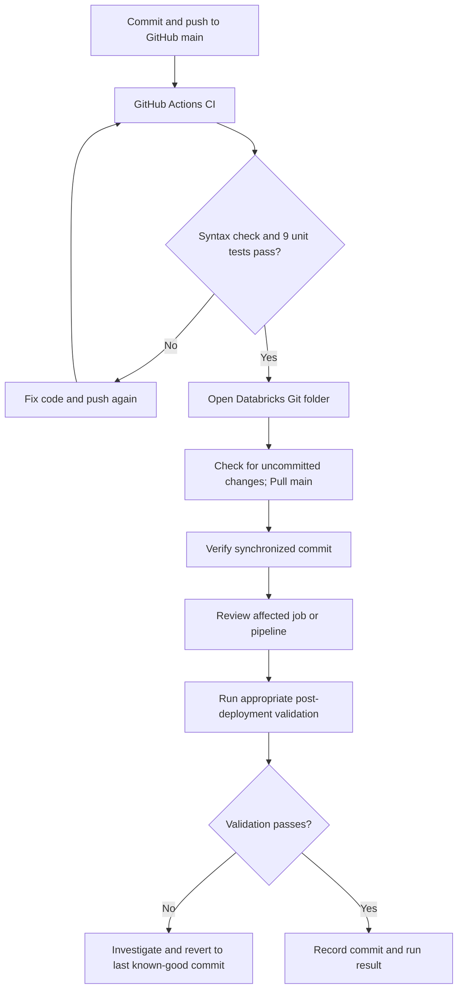

# SemiconPlus — Pipeline Operations Runbook

> **Scope:** Synthetic semiconductor manufacturing lakehouse. GitHub Actions CI with **manual Git-based deployment** to an existing Azure Databricks workspace. This is **not** automated continuous deployment.

## 1. CI/CD quick reference

**Current verified state (October 2026):** GitHub Actions CI succeeded with **9/9 unit tests** using Python 3.11.17 and pytest 9.1.1. Databricks Git folder was synchronized to `main` at commit `3575455` at the time of verification. The operational-validation job last succeeded **August 14, 2026**; this is historical evidence, **not** a post-deployment validation of the latest Git pull. No automated CD or post-pull regression run has been verified.

## 2. Before changing code

1. Use only **synthetic** data and public-safe code in the GitHub repository. Never commit Databricks tokens, secrets, real production data, or employer/customer information.
2. Identify which notebooks or scripts will change and which existing jobs depend on them.
3. For changes to ingestion, tables, schemas, or streaming logic, review the potential impact on existing Unity Catalog tables and streaming checkpoints before running anything.
4. Record the current known-good Git commit and relevant job/pipeline configuration before deployment.

## 3. Continuous integration — GitHub Actions

1. Push code to `main` or open a pull request targeting `main`.
2. Open [SemiconPlus GitHub Actions](https://github.com/kenbugasto/semiconplus-manufacturing-lakehouse/actions) and select **SemiconPlus CI**.
3. Open the relevant run and confirm the **Python Unit Tests** job succeeded.
4. The currently verified workflow checks Python syntax under `src/` and runs `python -m pytest tests/unit -v` (9 tests passed at last inspection).
5. **Do not deploy a commit with failed CI.** Note that these tests do not establish end-to-end Databricks pipeline correctness.

## 4. Manual deployment — Databricks Git folder

**Repository:** `kenbugasto/semiconplus-manufacturing-lakehouse`  
**Branch:** `main`  
**Databricks Git folder:** `/Repos/bugastokenpatrick@gmail.com/semiconplus-manufacturing-lakehouse`

1. Confirm GitHub Actions CI passed for the intended commit.
2. In the Databricks browser, open the SemiconPlus Git folder and its Git menu.
3. Confirm the branch is `main`. **Check for uncommitted changes before pulling**; do not overwrite or discard unexpected edits.
4. Click **Pull** to synchronize the approved changes.
5. Confirm the Git menu reports no unexpected pending changes and record the resulting commit SHA.
6. Review the affected job or pipeline source paths and settings. **Git pull updates repository files; it does not automatically update job definitions, pipeline settings, or Unity Catalog objects.**
7. Run only the necessary validation after checking expected compute costs and data effects.

### Existing source references

**Operational validation job:** `semiconplus-operational-validation`

| Task | Notebook path relative to Git folder |
|---|---|
| `initialize_run` | `src/operations/00_initialize_run.py` |
| `preflight_checks` | `src/operations/01_preflight_checks.py` |
| `quality_gate` | `src/operations/02_quality_gate.py` |
| `finalize_success` | `src/operations/03_finalize_success.py` |
| `record_failure` | `src/operations/04_record_failure.py` |

The job uses `semiconplus-shared-job-compute` according to the inspected configuration. Verify its actual task dependencies and success/failure conditions in the Jobs UI before editing them.

**Streaming pipeline:** `semiconplus-sdp-streaming`  
**Source:** `src/streaming/semiconplus_streaming_pipeline.py`  
**Observed settings:** Triggered, serverless, catalog `semiconplus_portfolio`, schema `bronze`. Its last displayed successful run was August 14, 2026. Avoid resetting checkpoints or doing a full refresh unless deliberately required and understood.

## 5. Batch and streaming operations

### Batch ingestion and transformations

Batch processing is executed via a **Databricks Job** (confirmed by project owner), but its **exact job name, task dependencies, and notebook order have not yet been verified**. Do not invent an execution sequence.

Before the next batch run:

1. Open **Jobs & Pipelines**, identify the batch job, and inspect the **Tasks** graph.
2. Record its job name, source notebook paths, dependencies, parameters, target catalog/schema, and compute type in this runbook.
3. Confirm the expected synthetic source files are present and that the run will not unintentionally duplicate or overwrite existing data.
4. Run the job only when needed; check each task's status, data-quality results, and output table updates.
5. Record the run ID, outcome, and any failures.

**Batch job name:** `TO VERIFY`  
**Task sequence:** `TO VERIFY`  
**Gold refresh/dependency order:** `TO VERIFY`

### Streaming pipeline

1. Confirm synthetic event files or input sources are ready.
2. Review the pipeline settings and whether the intended run is incremental.
3. Start a triggered update only when needed and within the Azure budget.
4. Review pipeline event logs, table update status, data-quality metrics, and checkpoints.
5. Record the update ID, outcome, and any issues. Do not claim streaming validation from a Git pull alone.

### Twice-weekly synthetic data append — flexible rest days

This is a **manual, flexible cadence**, not an automated schedule.

1. Choose two suitable rest days in the week; skip or reschedule if needed.
2. Generate or append **synthetic** data using the project's existing generation workflow.
3. Validate generated manifests, file counts, date coverage, and intentional quality-failure cases before ingestion.
4. Run the appropriate Databricks batch job, then any dependent streaming update or operational validation **in the order confirmed from actual job dependencies**.
5. Check ingestion audit, data-quality results, and Gold outputs; record run IDs and anomalies.

**Exact generator command, input volume, append location, and dependency order:** `TO VERIFY` from existing notebooks/job configuration. Do not run an unverified command against existing tables.

## 6. Post-deployment validation checklist

- [ ] Intended GitHub commit passed CI (syntax + 9 unit tests at last verified run).
- [ ] Databricks Git folder is on `main` and synchronized to the intended commit.
- [ ] No unexpected uncommitted changes were discarded.
- [ ] Affected job/pipeline still references the correct Git folder source files.
- [ ] Configuration and schema changes, if any, were reviewed separately.
- [ ] Relevant Databricks validation was run **after** deployment when required.
- [ ] Job/pipeline status, quality results, and run ID were recorded.
- [ ] No unexpected changes to Unity Catalog tables, streaming checkpoints, or compute costs occurred.

## 7. Failure handling and rollback

1. **Failed GitHub CI:** Stop; inspect the failing step, correct the code, and rerun CI before deployment.
2. **Git pull conflict or unexpected changes:** Stop and preserve the local edits. Resolve intentionally rather than force-resetting the repository.
3. **Failed Databricks validation:** Capture run ID, error details, affected task, and data-quality outputs. Do not blindly rerun ingestion or streaming updates.
4. **Code rollback:** Identify the last known-good Git commit, restore it through a reviewed Git revert/commit, confirm CI passes, and pull the corrected `main` branch into Databricks. Recheck job/pipeline references and validate again.
5. **Data rollback is separate:** Reverting Git does **not** undo Delta table writes, schema migrations, job settings, or streaming checkpoint changes. Assess these separately before remediation.

## 8. Minimal deployment log template

| Field | Value |
|---|---|
| Date / operator | |
| Git commit SHA | |
| GitHub CI result | |
| Changed paths | |
| Databricks Git pull result | |
| Affected batch job / pipeline | |
| Post-deployment validation run ID | |
| Validation result | |
| Notes / follow-up | |

## 9. Scope and limitations

- **Implemented:** GitHub Actions CI; manual Git synchronization into Databricks; verified source references for operational-validation job and streaming pipeline.
- **Not implemented:** Automatic deployment from GitHub Actions, separate staging/production promotion, automatic post-deployment testing, automatic Power BI Service refresh.
- **Not yet verified:** Batch job name/task graph; exact synthetic append commands; a successful validation run after the latest Git synchronization.

This runbook should be updated when the actual batch job graph and synthetic append process are inspected.
